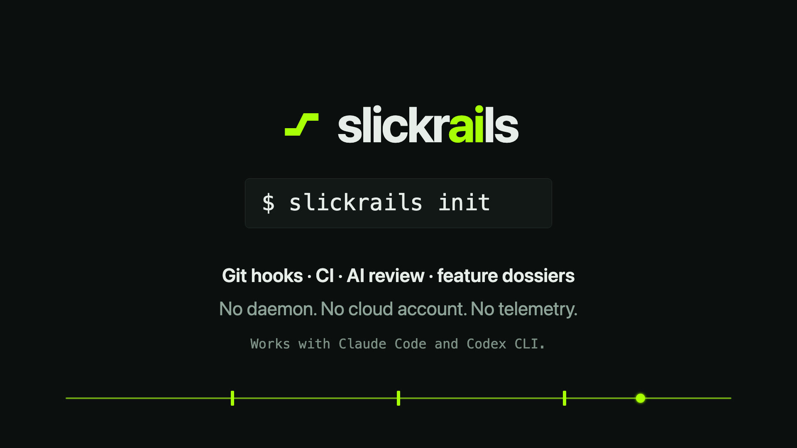
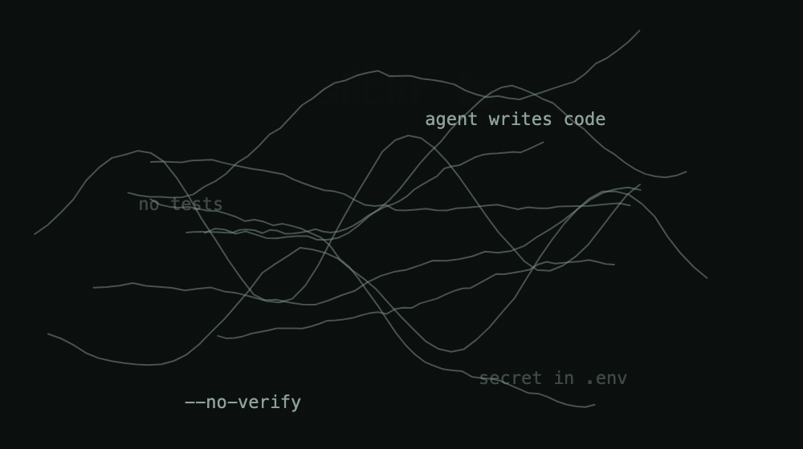
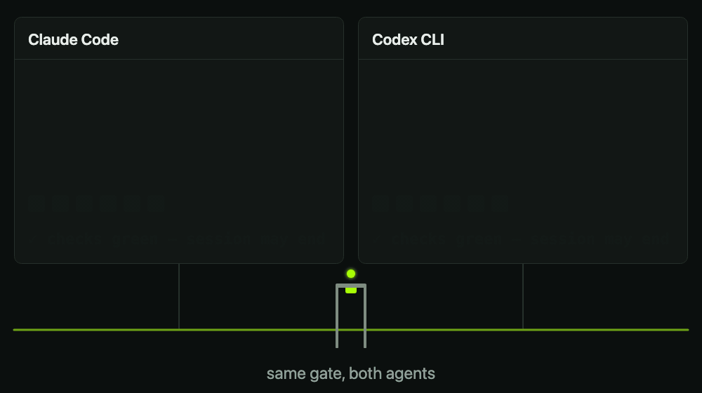
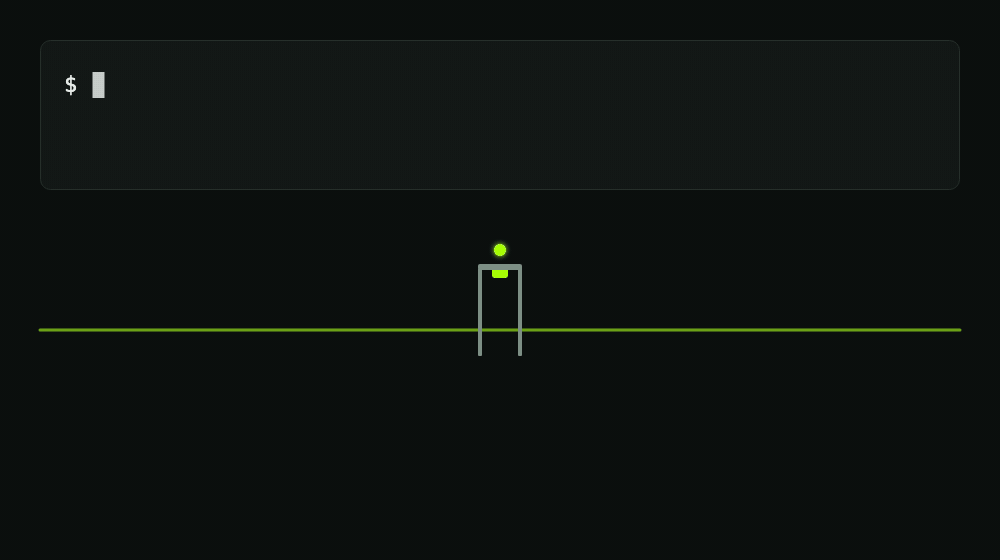
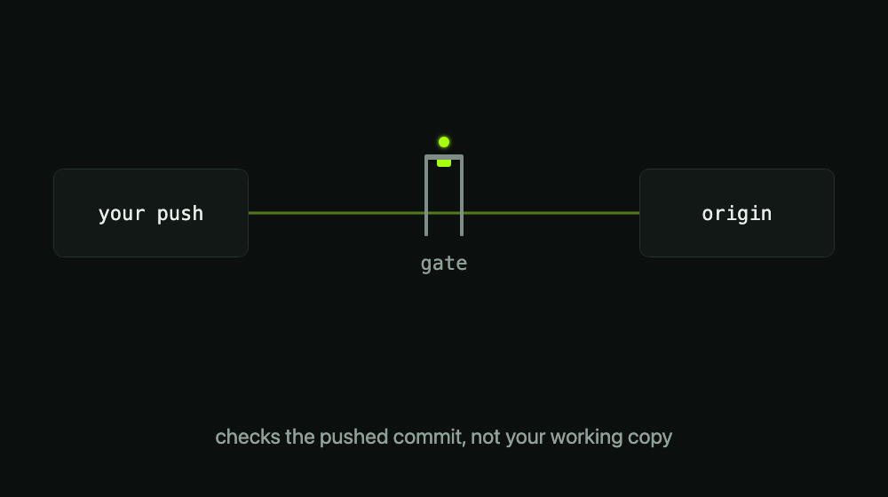
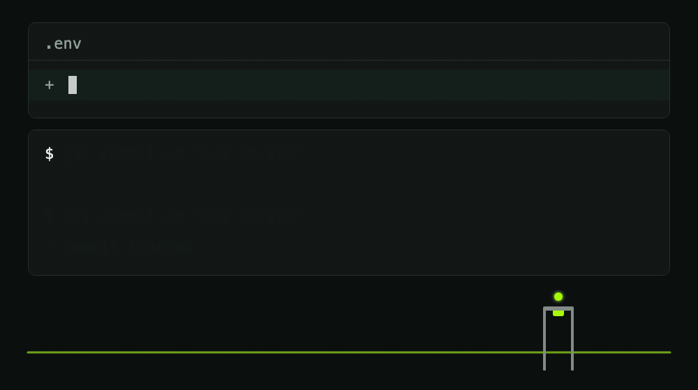
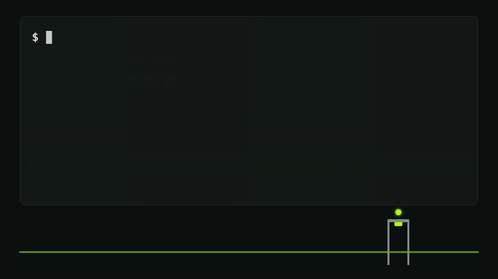

<p align="center">
  <a href="assets/slickrails-trailer.mp4"></a>
  <br><sub><a href="assets/slickrails-trailer.mp4">▶ Trailer ansehen (20 s, mit Ton)</a></sub>
</p>

# slickrails

> English (primary): [README.md](README.md) · Deutsches Regelwerk: [SLICKRAILS.de.md](SLICKRAILS.de.md)

**Guardrails für AI-gebaute Codebasen.** Heute kann jeder im Team bauen;
slickrails macht es sicher, das Gebaute auszuliefern. Ein Befehl zieht
einen verbindlichen Engineering-Standard in jedes Repo: Git-Hooks,
GitHub Actions, Branch Protection, AI-Review und eine Doku-Ebene, die das
*Warum* hinter AI-generiertem Code festhält, damit ein Dev zwei Monate
später nicht vor einem Zwei-Zeilen-Commit sitzt und rätselt.

Kein Daemon, kein Cloud-Account, keine Telemetrie. Nur lesbares
POSIX-Shell und YAML.

<p align="center">
  
</p>

Das Regelwerk selbst steht in [`SLICKRAILS.de.md`](SLICKRAILS.de.md):
12 Regeln, Ebenen-Modell, Escape Hatch.

## Schnellstart

```sh
# Eine Zeile: installiert das Kit nach ~/.slickrails und legt `slickrails` in den PATH
curl -fsSL https://raw.githubusercontent.com/l0kl97/slickrails/main/bootstrap.sh | sh

cd dein-projekt
slickrails init --lang de            # deutsche Doku-Templates
```

<p align="center">
  
</p>

Ohne `curl | sh`: Repo klonen und `sh slickrails/install.sh` im Projekt
ausführen, gleiches Ergebnis. `npx slickrails` und ein Homebrew-Tap
kommen mit dem ersten Release.

Der Installer erkennt den Stack, ist idempotent und überschreibt nie
bestehende Dateien: abweichende Versionen landen als `*.slickrails-new`
daneben. `slickrails doctor` prüft die Umgebung und, in einem Repo, ob
die Hooks wirklich verdrahtet sind und auf eine Probe richtig antworten
(der Guard blockiert `--no-verify`, pre-commit einen Test-Schlüssel).
`slickrails status` zeigt alles auf einem Bildschirm: Zustand, Checks,
Reviewer, offene Regeln, Dossiers, mit `--github` auch letzte CI und
Branch Protection.

Drei Dinge kann der Installer nicht für dich erledigen (er sagt es am
Ende):

1. **Git-Hooks in jedem Clone aktivieren.** `core.hooksPath` gilt nur
   pro Clone; jeder frische Clone braucht
   `git config core.hooksPath .githooks`. Ein vorhandener Hook-Manager
   (Husky) wird nie umgestellt; der Installer sagt, dass die Hooks *nicht*
   aktiv sind, und wie du sie verkettest.
2. **Agent-Hooks einmal freigeben.** Claude Code fragt vor neuen
   Projekt-Hooks; in Codex prüfst du sie mit `/hooks`.
3. **GitHub-Seite einrichten.** Branch Protection
   (`slickrails protect`, braucht `gh`) und das
   Review-Secret (siehe unten).

Der erste Commit nach `init` ist groß, deshalb verlangt der commit-msg-Hook
einen Body; der Installer druckt einen Befehl, der durchgeht.

## Claude Code und Codex CLI, gleich stark

<p align="center">
  
</p>

`slickrails init` verdrahtet dasselbe Stop-Gate und denselben Bash-Guard
in beide Agenten (`--agent claude|codex|both`, Standard beide). Beide
Konfigurationen (`.claude/settings.json`, `.codex/hooks.json`) rufen
dieselben Skripte.

- **Stop-Gate.** Die Session endet nicht, solange die Checks rot sind.
  Es prüft auch committete, aber nicht gepushte Arbeit, läuft unter
  einer eigenen Frist, wertet einen Absturz als rot, merkt sich grüne
  Zustände und lässt eine Session nach drei Blocks am unveränderten
  Zustand gehen, laut.
- **Bash-Guard.** Blockiert `--no-verify`, `git commit -n`,
  `SLICKRAILS_SKIP=` und das Abschalten der Hooks über `core.hooksPath`
  in den Shell-Befehlen eines Agenten. Der Ausweg gehört dem Menschen
  (`SLICKRAILS_ALLOW_BYPASS=1` in der Hook-Umgebung).

<p align="center">
  
</p>

Beides wurde gegen die echten CLIs gemessen (Claude Code 2.1.x, Codex CLI
0.163.0-alpha): Ein Hook, der in ein Timeout läuft oder abstürzt, lässt
die Session in beiden *durch*. Deshalb hat das Gate eine eigene, kürzere
Frist. Details und offene Punkte: [docs/guides/agent-parity.md](docs/guides/agent-parity.md).

## Optional: lokales Gate vor origin

```sh
slickrails gate init          # legt einen `gate`-Remote vor origin
git push gate mein-branch     # wird in einem Wegwerf-Worktree geprüft, nur bei Grün weitergereicht
```

<p align="center">
  
</p>

Geprüft wird der *gepushte Commit* mit deiner eigenen
`.slickrails/config.sh` (Setup, Typecheck, Tests, optional AI-Review),
nicht deine Arbeitskopie. Ein roter Push erreicht den echten Remote nie.
Die Idee stammt von [no-mistakes](https://github.com/kunchenguid/no-mistakes),
ohne Daemon, TUI und Agent-Pipeline. Geschützt sind nur Pushes über
`gate`. Details und Grenzen: [docs/features/local-gate.md](docs/features/local-gate.md).

## Was installiert wird

| Datei im Ziel-Repo | Zweck |
|---|---|
| `.slickrails/SLICKRAILS.md` | Das Regelwerk (Kopie des Standards) |
| `.slickrails/STATUS.md` | Welche Regeln greifen schon, welche nicht (Regel 10) |
| `.slickrails/config.sh` | Checks für die Hooks (pro Stack erkannt, anpassbar) |
| `.slickrails/rules.md` | Projektspezifische Review-Schwerpunkte |
| `.slickrails/review-learnings.md` | Team-Präferenzen, die jedes AI-Review beachtet |
| `.slickrails/session-check.sh` | Stop-Hook-Script: Session endet erst mit grünen Checks |
| `.slickrails/bash-guard.sh` | PreToolUse-Guard: blockiert `--no-verify`/`SLICKRAILS_SKIP=`, Schreibzugriffe auf die Guardrail-Dateien und destruktive Befehle (`git reset --hard`, Force-Push, `rm -rf ~`, DB-Reset) |
| `.slickrails/dep-check.sh` | Paket-Check des Guards: blockiert ein Paket, das jünger als 30 Tage ist und kaum genutzt wird; ein Name, den es auf npm/PyPI nicht gibt, wird nur gemeldet (Slopsquatting) |
| `.slickrails/ai-review.sh` | Lokales AI-Review vor jedem Push mit deinem `claude`- oder `codex`-CLI (ohne API-Key, ohne Daemon; der Installer schaltet es ein, wenn er eins findet) |
| `.claude/settings.json` | Claude-Code-Stop-Hook und Bash-Guard (Durchsetzung, nicht nur Anweisung) |
| `.codex/hooks.json` | dasselbe für das Codex-CLI; neue Projekt-Hooks müssen in Codex einmal freigegeben werden (`/hooks`) |
| `.githooks/pre-commit` | Secrets-Scan, .env-Block, optional Lint |
| `.githooks/commit-msg` | Body-Pflicht ab ~30 geänderten Zeilen (Warum + Was) |
| `.githooks/pre-push` | Typecheck + Tests vor jedem Push, geprüft wird, was gepusht wird |
| `.githooks/post-merge` | Erinnert nach dem Merge an Dossier und Changelog |
| `docs/features/` | Feature-Dossiers: Auftrag, Entscheidungen, Testweg, Bugfix-Historie |
| `.github/PULL_REQUEST_TEMPLATE.md` | PR-Template: Warum / Was / Wie getestet / Risiken |
| `.github/workflows/ci.yml` | Lint/Typecheck/Test/Build für den erkannten Stack |
| `.github/workflows/smoke.yml` | Playwright-Browser-Smoke-Tests (wenn Playwright da ist) |
| `.github/workflows/security.yml` | gitleaks + npm audit/pip-audit |
| `.github/workflows/claude-review.yml` | Optional (`slickrails github-review`): dasselbe AI-Review serverseitig auf jedem PR (braucht die Claude-GitHub-App und `CLAUDE_CODE_OAUTH_TOKEN` oder `ANTHROPIC_API_KEY`) |
| `.github/workflows/pr-size.yml` | PR-Größen-Wache: mehr als ~800 Zeilen blocken (Label `size-ok` als Ausnahme) |
| `.github/dependabot.yml` | Wöchentliche Dependency-Updates |
| `CLAUDE.md` + `AGENTS.md` (Block) | Verbindliche Regeln für jede AI-Session im Repo |

<p align="center">
  
  
</p>

## Nach dem Install

1. `.slickrails/config.sh` prüfen: Stimmen die Befehle für dieses Repo?
2. `.slickrails/STATUS.md` durchgehen, Lücken terminieren (vor allem Regel 2, Smoke-Tests).
3. `slickrails protect` (einmalig, braucht `gh auth login`).
4. Für das AI-Review auf PRs: die [Claude-GitHub-App](https://github.com/apps/claude) im Repo installieren und ein GitHub-Secret setzen (Settings → Secrets → Actions): `CLAUDE_CODE_OAUTH_TOKEN` (dein Claude-Abo, erzeugt mit `claude setup-token`) oder `ANTHROPIC_API_KEY`. `/install-github-app` in Claude Code erledigt beides; den PR mit dem zusätzlichen Review-Workflow, den es dabei öffnet, brauchst du neben slickrails nicht. Ohne die App scheitert der Review-Job, er wird nie still grün. Ob die Bedingungen deines Tarifs automatisierte Nutzung eines Abo-Tokens in der CI erlauben, musst du selbst prüfen (die Doku der Action nennt es, die Consumer-Bedingungen begrenzen automatisierte Nutzung); der API-Key ist die eindeutige Wahl. Das lokale AI-Review nutzt dein CLI-Login und braucht keins von beiden; nur `security-review-ai.yml` braucht einen API-Key. Ein Secret für mehrere Repos sollte ein API-Key sein: Das Abo-Token hängt an der Person, die es erzeugt hat.
5. Committen (der Installer druckt den passenden Befehl).

## Gemessen, nicht behauptet

`tests/benchmark/` pflanzt bekannte Fehler in ein Wegwerf-Repo und prüft,
ob das Kit sie stoppt, neben sauberen Kontrollen, die durchgehen müssen.

| Ebene | Ergebnis |
|---|---|
| L1 deterministisch (Hooks, Installer, Stop-Gate, Review-Wrapper) | 11 von 12 gepflanzten Fehlern gefangen, 0 von 10 sauberen Kontrollen fälschlich gemeldet. Der Fehlgriff ist ein generischer API-Key unter dem Regex-Fallback; mit `gitleaks` wird er gefangen |
| L2 echtes AI-Review (`BENCH_AI=1`, claude-sonnet-5-5) | 12 von 12 Fehlern, 0 von 6 Kontrollen gemeldet. Diese Ebene ist an der Decke und kann Qualitätsänderungen noch nicht zeigen |
| L3 Codex als Reviewer | nicht gelaufen: es gibt kein Codex-Review-Backend, das Harness meldet BLOCKED |

Die Test-Suite (`sh tests/run.sh`) läuft bei jeder Änderung in der CI. Der Benchmark ist eine Messlatte für das Kit, keine Garantie für
deinen Code. Siehe [docs/features/seeded-bug-benchmark.md](docs/features/seeded-bug-benchmark.md).

## Ehrliche Grenzen

- **Hooks sind Hinweise, CI und Branch Protection sind die Grenze.** Ein
  blockierter Agent kann ein Hook-Skript umschreiben (bei Codex beobachtet).
  Der Bash-Guard stoppt die üblichen Umgehungen, keine entschlossene.
- **Ein gepushter Commit bringt seine eigene `config.sh` mit**, wie in
  der CI; ein Commit, der seine Checks abschwächt, wird an den
  abgeschwächten Checks gemessen.
- **Die ganze Suite läuft grün in der GitHub-CI unter Linux (Ubuntu, git
  2.55, mawk), macOS und Windows (Git Bash, GNU awk)**, und alle drei
  blockieren einen Merge, wenn sie rot sind. Unter Git Bash dauert das
  Stoppen eines hängenden Checks etwa eine Sekunde (sein `ps` ist langsam);
  die Standard-Deadline des Stop-Gates lässt 30 s Luft.
- **Noch nicht auf echten Hosts gelaufen:** Branch Protection und der
  Security-Workflow auf GitHub, der interaktive Codex-Trust-Flow, das
  lokale Gate gegen einen echten GitHub- oder SSH-Remote.
- Offen geführt in [SLICKRAILS-STATUS.md](SLICKRAILS-STATUS.md).

## Woher die Ideen kommen

Evaluiert wurden [no-mistakes](https://github.com/kunchenguid/no-mistakes)
(Pre-Push-AI-Gate mit Daemon), [git-lrc](https://github.com/HexmosTech/git-lrc)
(Commit-Zeit-AI-Review mit Cloud-Service) und
[guardrails-ai](https://github.com/guardrails-ai/guardrails)
(LLM-Output-Validierung, anderes Problem). Die Entscheidung: die
Kernideen – Gate vor dem Push, Risiko-kategorisiertes Review,
versionierte Projekt-Regeln – selbst abbilden, ohne Daemon,
Cloud-Account oder Abo. Werkzeuge: Git-Hooks, GitHub Actions,
Claude Code (`/code-review`, claude-code-action). Aus no-mistakes kam
später der Kern des lokalen Gates dazu.

## Update-Strategie

Der Kit ist die eine Quelle. Änderungen am Standard hier machen, dann
`slickrails init` (bzw. `install.sh`) in den Projekten erneut ausführen.
Abweichungen tauchen als `*.slickrails-new` auf und werden bewusst gemergt.
