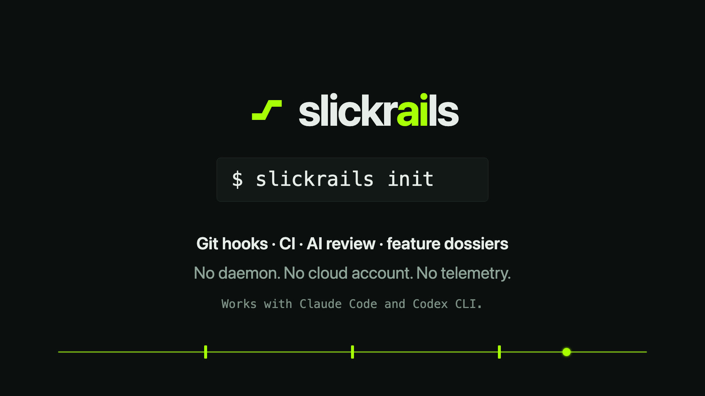
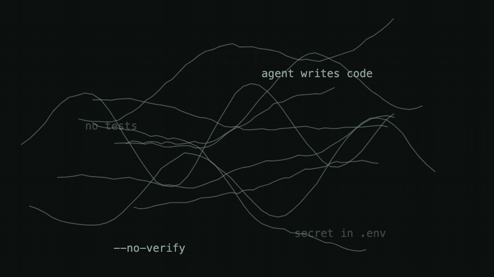
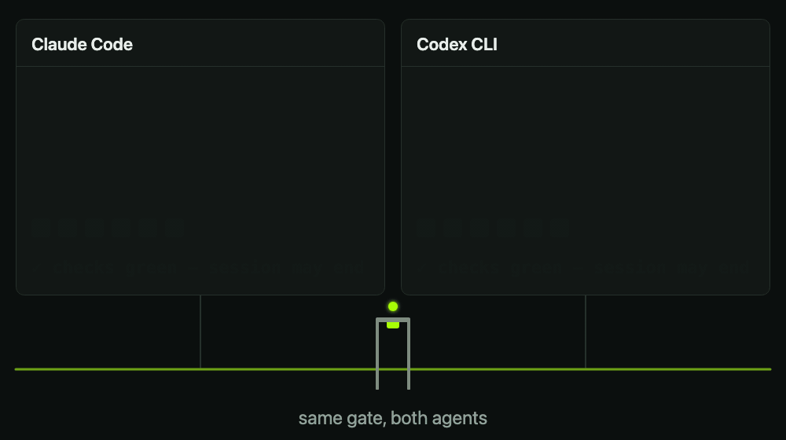
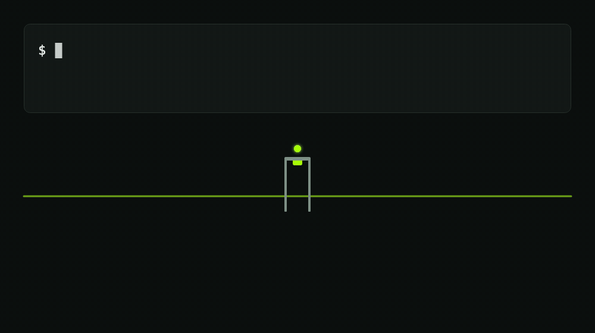
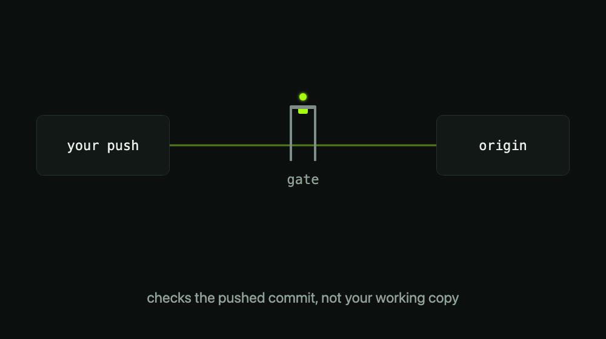
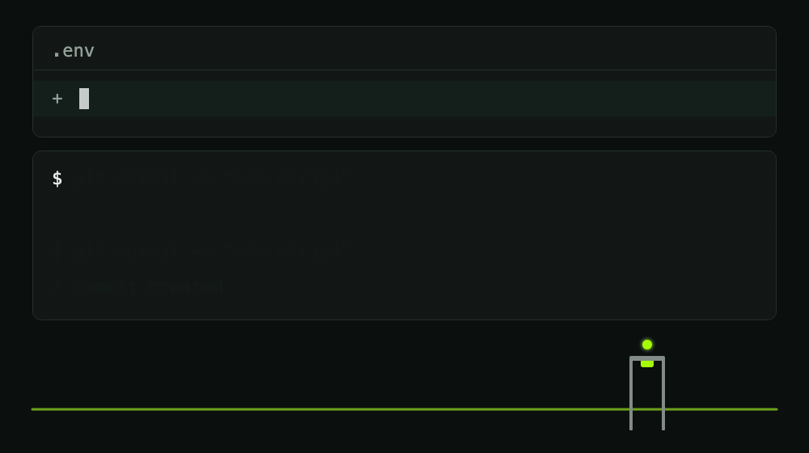
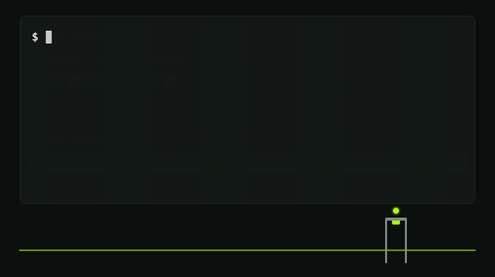

<p align="center">
  <a href="assets/slickrails-trailer.mp4"></a>
  <br><sub><a href="assets/slickrails-trailer.mp4">▶ Watch the trailer (20 s, with sound)</a></sub>
</p>

# slickrails

**Guardrails for AI-built codebases.** Everyone on your team can build
now; slickrails makes it safe to ship what they build. One command
pulls an enforced engineering standard into any repo: git hooks, GitHub
Actions, branch protection, AI review, and a documentation layer that
preserves the *why* behind AI-generated code, so a developer two months
later isn't staring at a two-line commit wondering what happened.

No daemon, no cloud account, no telemetry. Just inspectable POSIX shell
and YAML you can read in an afternoon.

> Deutsch? [README.de.md](README.de.md) · Regelwerk: [SLICKRAILS.de.md](SLICKRAILS.de.md)

## The problem

<p align="center">
  
</p>

AI coding tools turned everyone into a builder, including people who
have never written software. That's the point. But it creates a failure
mode no linter catches: the intent, decisions, and test path of a
feature live in a chat history that's gone tomorrow. Add the classic
AI-code pitfalls (insecure defaults, happy-path-only tests,
unreviewable 2,000-line PRs, code written as if it runs in a vacuum)
and you get fast code with no one left who understands it.

slickrails catches the mechanical failures with deterministic hooks
that can't be talked out of it, and assigns the judgment calls to fresh
AI reviewers with no author bias.

## Quickstart

```sh
# One line: installs the kit to ~/.slickrails and puts `slickrails` on PATH
curl -fsSL https://raw.githubusercontent.com/l0kl97/slickrails/main/bootstrap.sh | sh

cd your-project
slickrails init                      # or: slickrails init --lang de
```

<p align="center">
  
</p>

Prefer not to pipe curl into sh? Clone and run `sh slickrails/install.sh`
from your project for the same result. `npx slickrails` and a Homebrew
tap ship with the first release.

The installer detects your stack (Node/TypeScript with npm, pnpm, yarn
or bun, Python, Swift, Go, Rust, Ruby, JVM), is idempotent, and **never
overwrites existing files**: divergent updates land as
`*.slickrails-new` next to the original. `slickrails doctor` checks
your environment and, inside a repo, whether the hooks are really
wired up and answer a probe (the guard must block `--no-verify`,
pre-commit a staged test key); [docs/guides/stacks.md](docs/guides/stacks.md) lists what
each stack gets. `slickrails status` puts it on one screen: health,
checks, the reviewer, which rules are still open, the dossiers, and with
`--github` the last CI run and branch protection.

Three things the installer cannot do for you, and says so when it
finishes:

1. **Activate the git hooks in every clone.** `core.hooksPath` is local
   to a clone; each fresh clone needs `git config core.hooksPath .githooks`.
   An existing hook manager (Husky) is never switched; the installer
   tells you the hooks are *not* active and how to chain them.
2. **Trust the agent hooks once.** Claude Code asks before it runs new
   project hooks; in Codex you review them with `/hooks`.
3. **Set the GitHub side.** Branch protection (`slickrails protect`,
   needs `gh`) and the review secret (see [Requirements](#requirements)).

The first commit after `init` is a big one, so the commit-msg hook asks
for a body; the installer prints a command that passes.

## What you get

| Layer | Mechanism | Catches |
|---|---|---|
| Commit | `pre-commit` hook | secrets, `.env` files |
| Commit | `commit-msg` hook | large commits without a why+what body |
| Push | `pre-push` hook | red typecheck/tests leaving the machine |
| AI session | Stop hook for Claude Code and Codex CLI (+ Bash guard) | sessions claiming "done" while checks are red; `--no-verify` bypasses |
| PR | CI workflow (per stack) | lint, typecheck, tests, build |
| PR | Playwright smoke workflow | browser-only bugs unit tests can't see |
| PR | security workflow | leaked secrets in history, vulnerable deps |
| PR | `pr-size.yml` | unreviewable 2,000-line AI mega-PRs |
| Push | local AI review with your own `claude` or `codex` CLI — **the default**: your subscription, no API key, no GitHub App, no Actions minutes (on when setup finds one) | logic errors, injection, races, happy-path tests in the outgoing diff |
| PR (opt-in) | `claude-review.yml` via `slickrails github-review` — the same review server-side, for teams that want it enforced on GitHub | the same, on every PR; opens with a walkthrough, findings risk-ranked |
| Push (opt-in) | local gate: `git push gate <branch>` | the pushed commit is checked in a disposable worktree and forwarded only on green |
| PR (opt-in) | Anthropic security-review action | deep semantic security analysis, line-level comments (trusted PRs only) |
| Merge | branch protection script | direct pushes to main |
| After merge | `post-merge` hook | code landing without a dossier or changelog entry |
| Forever | feature dossiers (`docs/features/`) | "nobody remembers why this exists" |

### Claude Code and Codex CLI, equally strong

<p align="center">
  
</p>

`slickrails init` wires the same Stop gate and Bash guard into both
agents (`--agent claude|codex|both`, default both):
`.claude/settings.json` and `.codex/hooks.json` call the same scripts.

- **Stop gate.** The session cannot end while your checks are red. It
  also looks at committed-but-unpushed work, runs under its own
  deadline, treats a crash as red, caches green states, and lets a
  session go after three blocks at an unchanged state, loudly.
- **Bash guard.** Blocks `--no-verify`, `git commit -n`,
  `SLICKRAILS_SKIP=` and switching hooks off via `core.hooksPath` in an
  agent's shell commands, and writes to the guardrail files themselves
  (hook scripts, `config.sh`, `.githooks/`, agent hook settings), also
  through Claude Code's edit tools. It stops commands that destroy work
  or data: `git reset --hard`, `git clean -f`, `git push --force`, a
  forced push onto main, discarding every change, `rm -r` on `/ ~ . .git`,
  database resets and `DROP`/`TRUNCATE`. The way out belongs to the
  human: `SLICKRAILS_ALLOW_BYPASS=1` / `SLICKRAILS_ALLOW_DESTRUCTIVE=1`
  in the hook environment, or running the command yourself (`! <command>`).
- **Package check.** Before an agent installs a package by name (npm,
  pnpm, yarn, bun, pip, uv, poetry), the guard asks the registry: a
  package younger than 30 days with little use is blocked (a made-up
  name that someone registered is how slopsquatting gets in); a name
  that is not there at all is pointed out. Private registries and
  workspace packages are left alone, it fails open without network, and
  `SLICKRAILS_ALLOW_NEW_DEPS=1` is the human's way out.

<p align="center">
  
</p>

Both were measured against the real CLIs (Claude Code 2.1.x, Codex CLI
0.163.0-alpha): a hook that times out or crashes fails *open* in both,
which is why the gate keeps its own shorter deadline. Details and the
open parts: [docs/guides/agent-parity.md](docs/guides/agent-parity.md).

### Optional: a local gate before origin

```sh
slickrails gate init          # adds a `gate` remote in front of origin
git push gate my-branch       # checked in a disposable worktree, forwarded only on green
```

<p align="center">
  
</p>

The *pushed commit* is checked with your own `.slickrails/config.sh`
(setup, typecheck, tests, optional AI review), not your working copy.
A red push never reaches the real remote. The idea comes from
[no-mistakes](https://github.com/kunchenguid/no-mistakes), without the
daemon, TUI or agent pipeline. Only pushes made through `gate` are
gated. Details and limits: [docs/features/local-gate.md](docs/features/local-gate.md).

<p align="center">
  
  
</p>

Built a feature without a dossier? `slickrails dossier` drafts one from
the diff. The original ask stays a `[FILL IN]`: it never invents what
it can't know. The PR checks are also available as reusable actions,
`l0kl97/slickrails/actions/pr-size@main` and
`l0kl97/slickrails/actions/claude-review@main`.

The full standard lives in [SLICKRAILS.md](SLICKRAILS.md): 12 rules,
the layer model, and a mapping of the ten classic AI-code pitfalls to
the mechanism that catches each one.

## The part nothing else does: context that survives

Every feature gets a dossier (`docs/features/<slug>.md`) that the AI
session itself writes and maintains: the original ask in plain language,
the decisions made, where the code lives, how to test it, and a bugfix
history. The human builder doesn't need to know how to document.
The rules block that `install.sh` adds to `CLAUDE.md` and `AGENTS.md`
makes it the agent's job, and the commit-msg hook makes thin commit
messages physically impossible for large diffs.

## See it while you work

The `slickrails-status` mod puts one line into Claude Code's status line,
refreshed after every turn, and `/slickrails` prints the whole picture:

```
slickrails ✓ guard · review claude · checks ✓ · 6 rules open
```

```
/plugin marketplace add l0kl97/slickrails
/plugin install slickrails-status@slickrails
```

`slickrails init --status-mod` offers it to everyone who opens the repo
(Claude Code asks each person once). The facts come from
`slickrails status --porcelain`; outside a slickrails repo the line stays
empty.

## Reviews that adapt

Every AI review (the pre-push review with your own `claude` or `codex`,
the opt-in PR workflow, local `/code-review` sessions) honors two files in your repo:
`.slickrails/rules.md` for project rules, and
`.slickrails/review-learnings.md` for accumulated team preferences.
Waive a finding type once and it stays waived; tighten one and it
always fires. `REVIEW_PROFILE` in `config.sh` sets the strictness:
`quiet`, `chill` (default), or `assertive`. Adaptive review, without a
SaaS reading your code.

## Measured, not claimed

`tests/benchmark/` seeds known faults into a throwaway repo and checks
whether the kit stops them, next to clean controls that must pass.

| Layer | Result |
|---|---|
| L1 deterministic (hooks, installer, Stop gate, review wrapper) | 11 of 12 seeded faults caught, 0 of 10 clean controls flagged. The miss is a generic API key under the regex fallback; with `gitleaks` installed it is caught |
| L2 real AI review (`BENCH_AI=1`, claude-sonnet-5-5) | 12 of 12 faults, 0 of 6 controls flagged. This layer is at its ceiling and cannot show quality changes yet |
| L3 Codex as reviewer | not run: no Codex review backend exists, the harness reports BLOCKED |

The test suite (`sh tests/run.sh`) runs in CI on every change.
The benchmark is a yardstick for the kit, not a guarantee for your code.
See [docs/features/seeded-bug-benchmark.md](docs/features/seeded-bug-benchmark.md).

## Honest limits

- **Hooks are hints, CI and branch protection are the boundary.** An
  agent that is blocked can edit a hook script (we watched Codex do it).
  The Bash guard stops the common bypasses, not a determined one.
- **A pushed commit brings its own `config.sh`**, like in CI; a commit
  that weakens its checks is judged by the weakened checks.
- **The full suite runs green in GitHub CI on Linux (Ubuntu, git 2.55,
  mawk), macOS and Windows (Git Bash, GNU awk)**, and all three block a
  merge when red. On Git Bash, stopping a hung check takes about a
  second (its `ps` is slow); the Stop gate's default deadline leaves 30 s.
- **Not yet run on real hosts:** branch protection and the security
  workflow on GitHub, the interactive Codex trust flow, the local gate
  against a real GitHub or SSH remote.
- Tracked openly in [SLICKRAILS-STATUS.md](SLICKRAILS-STATUS.md).

## How it compares

| | slickrails | husky / pre-commit | no-mistakes | git-lrc | CodeRabbit |
|---|---|---|---|---|---|
| Git hooks | ✓ | ✓ | – | ✓ | – |
| CI / branch protection setup | ✓ | – | – | – | – |
| AI review on PRs | ✓ | – | ✓ | ✓ | ✓ |
| Adaptive learnings / review profiles | ✓ | – | – | ✓ | ✓ |
| AI-session enforcement (Stop hook) | ✓ | – | – | – | – |
| Context docs for AI-built features | ✓ | – | – | – | – |
| Runs without daemon/cloud/account | ✓ | ✓ | – (daemon) | – (cloud) | – (SaaS) |
| Cost | free | free | your API keys | freemium | paid |

## Design principles

1. **Deterministic where possible, AI where necessary.** Mechanical
   checks are hooks; they can't be persuaded. Judgment is done by fresh
   AI instances with no author bias.
2. **Every guardrail has a loud escape hatch, and it belongs to the
   human.** `SLICKRAILS_SKIP=1`, `--no-verify`, the `size-ok` label are
   allowed for you, with the reason on the record. An agent's shell
   commands that try them are blocked by the Bash guard.
3. **Never overwrite, never phone home.** The installer respects
   existing files; nothing leaves your machine.
4. **Gaps are visible.** `.slickrails/STATUS.md` tracks which rules are
   live in each repo. An honest TODO beats silent non-compliance.

## Requirements

macOS, Linux or Windows with Git Bash (Git for Windows), and `git`. Optional but recommended: `gitleaks` for real secrets
scanning (a pattern-based fallback runs without it), `gh` for branch
protection, Node 18+ for Node projects, and the `claude` or `codex` CLI
for the local AI review before every push (the installer turns it on with
whichever it finds; `--review off` to skip, `REVIEW_CLI` in `config.sh` to
pick) and `claude` for `slickrails dossier`. The optional PR review on
GitHub (`slickrails github-review`) needs the [Claude GitHub App](https://github.com/apps/claude) on the repo
and one repo secret: `CLAUDE_CODE_OAUTH_TOKEN` (your Claude subscription;
create it with `claude setup-token`) or `ANTHROPIC_API_KEY`.
`/install-github-app` in Claude Code sets up both; it also opens a pull
request with its own review workflow, which you do not need next to
slickrails'. Without the app the review job fails, it never passes silently. The local AI
review (`claude -p` or `codex exec`) needs neither: it uses your CLI login. Whether your
plan's terms allow automated use of a subscription token in CI is yours
to check (the Action's docs list it; the consumer terms limit automated
use); an API key is the unambiguous choice. The opt-in
`security-review-ai.yml` still needs an API key.

## Contributing

See [CONTRIBUTING.md](CONTRIBUTING.md). Run `sh tests/run.sh` before
opening a PR; this repo dogfoods its own hooks. Stack adapters (PHP,
Elixir, Deno, ...) and agent integrations are the most wanted
contributions. [ROADMAP.md](ROADMAP.md) has the plan.

## License

[MIT](LICENSE)
